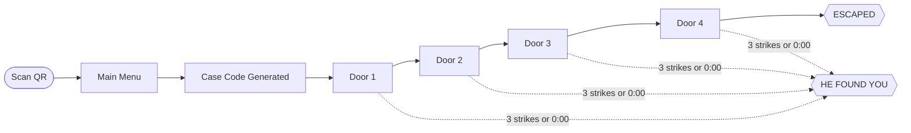

<div align="center">


# LOCKDOWN

### Blackthorn Manor

**A two-player asymmetric escape game for live events.**
One player is locked inside. The other holds the only manual.

<br>

-8c0f15?style=for-the-badge)


**A game by D'SAITECH**

[Overview](#overview) &nbsp;•&nbsp; [Quick Start](#quick-start) &nbsp;•&nbsp; [Event Setup](#event-setup) &nbsp;•&nbsp; [Game Design](#game-design) &nbsp;•&nbsp; [Configuration](#configuration) &nbsp;•&nbsp; [Testing](#testing) &nbsp;•&nbsp; [Credits](#credits)

</div>

---

## Table of Contents

| # | Section | Description |
|:-:|---|---|
| 01 | [Overview](#overview) | What the game is and how a run plays out |
| 02 | [Prerequisites](#prerequisites) | Software and accounts required |
| 03 | [Quick Start](#quick-start) | Install, test, run locally |
| 04 | [Event Setup](#event-setup) | QR code, printed manual, booth checklist |
| 05 | [Project Structure](#project-structure) | Folder and architecture map |
| 06 | [Game Design](#game-design) | Case codes, the four locks, the clock |
| 07 | [Configuration](#configuration) | URL parameters, themes, difficulty presets |
| 08 | [Testing](#testing) | Automated validation and smoke tests |
| 09 | [Audio, Visuals and Safety](#audio-visuals-and-safety) | Scare director, Web Audio, accessibility |
| 10 | [Troubleshooting](#troubleshooting) | Symptom, cause, fix |
| 11 | [Known Limits](#known-limits) | What is proven and what needs on-site checks |
| 12 | [Credits](#credits) | Who made this |

---

## Overview

**LOCKDOWN** is an asymmetric cooperative game in the style of *Keep Talking and Nobody Explodes*. It needs no server, no accounts, and no networking. Two players share one phone and one printed manual.

### Roles

| Role | Holds | Sees | Responsibility |
|---|---|---|---|
| **The Escapee** | A phone, opened by QR code | The four locks, case code, clock, killer proximity | Describes what is on screen and operates the locks on instruction |
| **The Handler** | A printed A4 manual (6 pages) | The manual only, **never the screen** | Reads the rules, asks questions, gives one instruction at a time |

### Anatomy of a Run



1. The Escapee scans the QR code. The **main menu** offers **ENTER THE HOUSE**, **ESCAPEE'S INSTRUCTIONS**, and **CREDITS**. Tapping **ENTER THE HOUSE** generates a **case code** such as `K7-3-RED` and starts the clock at **4:00** (240 seconds on normal difficulty).
2. Four locked doors appear in an order shuffled per case code: **BRASS TUMBLER**, **GLYPH PAD**, **FUSE BOX**, and **EXECUTION SWITCH**.
3. At each door the Escapee reads the **plate name** aloud. The Handler finds that page. The manual rules, combined with the case code and on-screen details, yield exactly one correct solution.
4. A wrong action is a **strike**. Each strike costs **15 seconds** and moves the killer closer with an audio burst. **Three strikes, or zero seconds, ends the run.**
5. Clearing all four doors shows **ESCAPED** with the remaining time in large numerals. Otherwise the screen reads **HE FOUND YOU**. Both end screens offer **PLAY AGAIN / TRY AGAIN** and **MAIN MENU**, along with a thank-you from D'SAITECH.

> [!NOTE]
> A **MENU** button in the HUD lets a player leave a run at any time. The game asks for confirmation first, and the clock is held while the question is open.

### Key Properties

| Property | Detail |
|---|---|
| **Deterministic** | 3,888 case codes. Every puzzle is generated from the case code by a seeded RNG. |
| **Provably solvable** | A validator exhaustively proves that every seed has exactly one valid solution. |
| **Rules, not answers** | The manual contains rules only. No fixed answers are printed anywhere. |
| **Decoy plates** | Five look-alike plates (**IRON TUMBLER**, **NUMBER PAD**, **GAS VALVE**, **RELAY BOARD**, **VAULT WHEEL**) share pages with real doors. Players must communicate plate names exactly. |
| **Zero backend** | No servers, no accounts, no tracking. Fully offline after first load. |

---

## Prerequisites

| Tool | Version | Purpose | Link |
|---|---|---|---|
| **Node.js** | LTS 20 or newer | Build and test tooling | [nodejs.org](https://nodejs.org) |
| **Git** | Any recent version | Version control | [git-scm.com](https://git-scm.com) |
| **GitHub account** | n/a | Source hosting | [github.com](https://github.com) |
| **Vercel account** | n/a | Production hosting | [vercel.com](https://vercel.com) |

Verify your Node installation:

```bash
node -v
npm -v
```

---

## Quick Start

```bash
# 1. Install dependencies
npm install

# 2. Run the full test suite (validator + smoke tests)
npm test

# 3. Start the local dev server
npm run dev
```

### Local URLs

| URL | Purpose |
|---|---|
| `http://localhost:5173/` | Main menu, then a standard run |
| `http://localhost:5173/?case=K7-3-RED` | Run with a fixed seed |
| `http://localhost:5173/?case=K7-3-RED&debug` | Fixed seed with on-screen answer *(staff only)* |
| `http://localhost:5173/?stats` | End screen with per-door clearance times, theme, gentle mode, and quality status |
| `http://localhost:5173/?theme=light` | Preview the "Lights On" theme |
| `http://localhost:5173/?gentle=1` | Preview Gentle Mode |
| `http://localhost:5173/escapee/` | Escapee's instructions page (the main menu links here), with a **MAIN MENU** link back |
| `http://localhost:5173/manual/` | Rendered 6-page manual, with a **MAIN MENU** link back to the game |
| `http://localhost:5173/admin/?case=K7-3-RED` | 4-module answer key |
| `http://localhost:5173/facilitator/` | 1-page booth briefing sheet |

---


## Event Setup

### QR Code

```bash
npm run qr -- https://lockdown-booth.vercel.app/
```

This writes `qr/lockdown-qr.png` (1200 px) and `qr/lockdown-qr.svg`. Print at a **minimum of 8 cm** on matte cardstock.

### Printing the Handler's Manual

Open `https://YOUR-DOMAIN/manual/` in Chrome or Edge and print with `Ctrl + P`.

| Setting | Value |
|---|---|
| Paper | **A4** |
| Scale | **100%** |
| Margins | **Default** (the page sets its own, so *None* also works) |
| Headers and footers | **Off** |
| Black and white | Background graphics **off** |
| Color (`/manual/?color=1`) | Background graphics **on** |

Ready-made PDFs are in `docs/print/` (`LOCKDOWN-Handlers-Manual-BW.pdf` and `-Color.pdf`). Regenerate them after any rule or layout change:

```bash
node tools/manual-pdf.mjs
```

See the file header for the one extra dependency it needs.

**Manual contents (6 pages, all A4, no door split across pages)**

| Page | Content |
|:-:|---|
| 1 | Cover with the D'SAITECH logo, what the game is, the two roles, the clock and strikes |
| 2 | How to play as the Handler, how to read a rule, page finder, talking tips |
| 3 | **FUSE BOX**, NUMBER PAD and VAULT WHEEL *(look-alikes)* |
| 4 | **GLYPH PAD** (6 columns of 6 glyphs) |
| 5 | **EXECUTION SWITCH** (with a COLOR start table), GAS VALVE and RELAY BOARD *(look-alikes)* |
| 6 | **BRASS TUMBLER**, IRON TUMBLER *(look-alike)*, thank-you and credits (always the last page) |

Every door section starts with an **ASK YOUR PARTNER** line (what to get from the Escapee), then numbered **STEPS**. Page 2 has a short "how to read a rule" guide.

> [!TIP]
> If edited rule text spills past a page frame, that page gets a red outline at `/manual/`. Shorten the text or move a block in `LAYOUT` (`src/manual/build.js`).

Also print `/facilitator/` (1 page) for the booth table.

### Booth Checklist

- [ ] 2 loaner phones preloaded with the game, volume at 80%, silent switch off, Auto-Lock disabled
- [ ] 1 printed manual (6 pages) per station, plus 2 spare copies
- [ ] Facilitator sheet on the table
- [ ] QR code printed at 8 cm or larger
- [ ] Offline mode verified on every loaner phone

### 20-Second Briefing

> *"You are locked in a killer's house. You have four minutes to escape through four locked doors. One of you is the Escapee holding the phone; one is the Handler with the case file. You cannot look at each other's materials. Talk fast, describe what you see, and give clear orders. Three strikes and he finds you. Sound up. Tap ENTER."*

---

## Project Structure

```text
lockdown/
├─ index.html
├─ vite.config.js
├─ vercel.json
├─ public/
│  ├─ sw.js                  PWA cache v3 (offline support)
│  └─ manifest.webmanifest
├─ src/
│  ├─ config.js              4:00 clock, 4 doors, difficulty presets
│  ├─ main.js                entry point
│  ├─ style.css              dark and light themes, scare layers, lock views
│  ├─ assets/
│  │  ├─ logo.png            D'SAITECH logo (replace this file to rebrand)
│  │  └─ logo-url.js         resolves the logo for the game and the manual
│  ├─ core/
│  │  ├─ rng.js              seeded PRNG (mulberry32 + xmur3)
│  │  ├─ code.js             format, parse, 3,888 cases
│  │  ├─ plan.js             case code to 4 shuffled doors
│  │  └─ run.js              state machine (remaining, proximity, strikes)
│  ├─ modules/
│  │  ├─ tumbler/            logic.js + view.js
│  │  ├─ glyphs/             logic.js + view.js + columns.js
│  │  ├─ fuse/               logic.js + view.js
│  │  └─ switch/             logic.js + view.js
│  ├─ ui/
│  │  ├─ shell.js            main menu, credits, HUD, exit/pause/rotate holds, end screens
│  │  ├─ visuals.js          scare overlays (glass slam, face, blackout, blood)
│  │  ├─ flash-limiter.js    photosensitivity safety rail (max 3 flashes/sec)
│  │  ├─ haptics.js          heartbeat vibration pulses and strike buzz
│  │  ├─ glyphs.js           SVG glyph definitions
│  │  └─ dom.js              button binding (with reusable support)
│  ├─ audio/
│  │  ├─ synth.js            core oscillators, noise buffers, master compressor
│  │  ├─ ambience.js         drone, footsteps, heartbeat, heavy breathing
│  │  ├─ effects.js          creaks, slams, whispers, music box, phone ring
│  │  ├─ stingers.js         6 normalized stingers plus tinnitus
│  │  └─ engine.js           unified audio facade
│  ├─ scare/
│  │  └─ director.js         intensity curve, beat scheduler, cooldowns
│  ├─ manual/                6-page A4 manual builder + manual.css
│  └─ admin/                 4-module answer key
├─ tools/
│  ├─ validate.mjs           exhaustive 3,888-case validator
│  ├─ reference.mjs          independent rule reference interpreter
│  ├─ smoke.mjs              jsdom end-to-end smoke test
│  ├─ manual-pdf.mjs         regenerates docs/print/*.pdf (A4)
│  └─ qr.mjs                 QR code generator
├─ docs/                     DEPLOY.md, PLAYTEST.md, CONTRIBUTING.md, playtest-log.csv
│  └─ print/                 ready-to-print manual PDFs (A4)
└─ CREDITS.md                full credits
```

---

## Game Design

### Case Code Format

`K7-3-RED` is composed of four parts, giving **3,888** unique codes.

| Part | Example | Options |
|---|:-:|:-:|
| LETTER | `K` | 12 |
| SERIAL | `7` | 1 to 9 |
| ROOM | `3` | 1 to 9 |
| COLOR | `RED` | 4 |

### The Four Locks

<table>
<tr>
<td width="50%" valign="top">

#### 1. Brass Tumbler
Five pins, three decisions. (1) A pin showing the SKULL is tapped at the very end. (2) ROOM odd: read the other pins left to right; ROOM even: right to left. (3) In that order, tap the pins matching the case COLOR first, then the rest, then the skull.

</td>
<td width="50%" valign="top">

#### 2. Glyph Pad
Four glyphs on screen. Locate the single manual column, out of six, that contains all of them. If SERIAL is odd, press top to bottom. If SERIAL is even, press bottom to top.

</td>
</tr>
<tr>
<td width="50%" valign="top">

#### 3. Fuse Box
Three to six wires. Cut rules branch on wire count, paper tags (every wire shows a clear TAG or NO TAG), ROOM parity, vowel letter, and case color.

</td>
<td width="50%" valign="top">

#### 4. Execution Switch
Six lettered switches and a looping countdown (20 down to 0, then restart). The correct switch is the one showing the case LETTER, which is always on the panel. The correct number is the COLOR start (RED 2, BLUE 4, YELLOW 7, WHITE 10) plus SERIAL. Flip the switch while the countdown shows that number.

</td>
</tr>
</table>

**Execution Switch timing:** the window is roughly 1.35 seconds, with 0.1 s of early grace and 0.25 s of late grace. A wrong switch or a mistimed flip is a strike: 15 s off the clock, an electrical arc and wail, and the killer's footsteps close in.

---

## Configuration

### URL Parameters

| Parameter | Effect |
|---|---|
| `?case=K7-3-RED` | Fix the case code |
| `?debug` | Show the answer in the HUD and detailed end-screen statistics *(staff only)* |
| `?stats` | Log per-module timings, theme, gentle mode, and quality status on the end screen |
| `?theme=light\|dark` | Override the theme. `light` is "Lights On", `dark` is "Lights Out" |
| `?gentle=1` | Enable Gentle Mode |
| `?difficulty=easy\|normal\|hard` | Swap the difficulty preset |

### Difficulty Presets

Defined in `src/config.js`.

| Preset | Total Time | Strike Penalty | Killer Speed |
|---|:-:|:-:|:-:|
| `easy` | 300 s (5:00) | 10 s | 0.9 |
| `normal` | 240 s (4:00) | 15 s | 1.0 |
| `hard` | 200 s (3:20) | 20 s | 1.1 |

---

## Testing

| Command | What it does |
|---|---|
| `npm run validate` | Tests all 3,888 case codes across all four modules against an independent reference interpreter. Verifies there are no dead rules, runs statistical sanity checks, and confirms the 6-page manual contains every rule line verbatim plus the D'SAITECH credit and logo. |
| `npm run smoke` | Simulates perfect play and a 3-strike failure in JSDOM. Covers the main menu, the credits screen, and every route back to the menu. Verifies flash limiter rules and confirms that mid-game theme toggling does not affect the clock. |
| `npm run build` | Validates, then produces the production build in `dist/`. |
| `npm test` | Runs the validator and the smoke test together. |

---

## Audio, Visuals and Safety

### Scare Director

`src/scare/director.js` orchestrates atmospheric events from an intensity curve driven by proximity, strikes, door number, and time remaining.

| Moment | Guaranteed beat |
|---|---|
| Door 1, about 4 s in | Subtle ambient event: a whisper and a peripheral shadow |
| Door 3 | Hard scare: a hand slams on the glass and cracks spread |
| Door 4 | Fake-out rattle, followed 3.8 s later by a killer silhouette behind the glass |
| Door 4, after the fake-out | A corner lurker settles in |
| Final 20 seconds | Final surge |

### Safety Rails

| Safeguard | Behavior |
|---|---|
| **Flash limiter** (`src/ui/flash-limiter.js`) | Enforces a maximum of 3 flashes per second anywhere in the game |
| **Master compressor** | A Web Audio dynamics compressor protects hearing from piercing peaks |
| **Gentle Mode** | Available from a checkbox on the start screen or `?gentle=1`. Removes all full strobes, blackouts, and lunges, and softens audio stingers |
| **Readability guarantee** | No scare covers puzzle text or controls for more than 0.6 s. All scare layers use `pointer-events: none` |
| **Grace period** | No scare triggers in the first 3 s of a new door, so the Escapee can read the plate name |
| **Adaptive quality guard** | Measures frame times during play. If the 95th percentile exceeds 24 ms for 3 seconds, film grain and heavy SVG filters are disabled automatically and the degradation is logged in end-screen stats |

### Themes

| Theme | Look | Accessibility |
|---|---|---|
| **Dark** ("Lights Out") | Pitch black, cold flashlight whites, blood red accents | WCAG AA |
| **Light** ("Lights On") | Dim yellow bulb, aged wallpaper, dark ochre surfaces | WCAG AA |

---

## Troubleshooting

| Symptom | Cause | Fix |
|---|---|---|
| `npm test` fails | A case code violates a rule or the manual drifted from the rules | Inspect the failing case code in the error log |
| Audio is silent | Mobile browsers require a tap to unlock Web Audio | Tap **ENTER THE HOUSE**. On iOS, also check that the physical silent switch is off |
| No vibration | iOS Safari does not support the Web Vibration API | Expected behavior. No fix needed |
| PWA does not reload offline | The game was never loaded online over HTTPS | Load the game once online, then retry |

---

## Known Limits

### Proven by Automated Tests

- Mathematical determinism and a single-solution guarantee across all 3,888 seeds for all four modules
- Concordance with an independent reference implementation
- 6-page A4 manual print structure, with a page-overflow guard on `/manual/`

### Requires On-Site Hardware Verification

- Audio levels on real phone speakers versus wired headphones (run the scare audit in `docs/PLAYTEST.md`)
- Touch target accuracy on low-end Android screens under 360 px viewport width
- Effect of booth ambient lighting on the readability of the printed A4 manual

---

## Credits

<div align="center">


**LOCKDOWN · Blackthorn Manor is a game by D'SAITECH.**

</div>

| Role | Name |
|---|---|
| **Organization** | D'SAITECH |
| **Main Developer** | **D'SAITECH Secretary - Ericksson Brutas** |
| **Scope** | Game design, code, sound, puzzle rules, and the Handler's manual |

Built with [Vite](https://vitejs.dev) and vanilla JavaScript. Every sound is synthesized live with the Web Audio API. No servers, no accounts, no tracking.

The credit appears in the game (main menu, credits screen, and both end screens), in the printed manual (cover, running footer, and closing thank-you), on the facilitator sheet, on the answer key, and in every document under `docs/`. The full list is in [CREDITS.md](CREDITS.md).

<div align="center">

<br>

**Thank you for playing.**

© D'SAITECH. All rights reserved.

</div>
